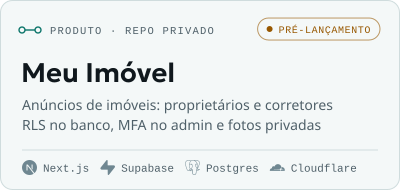
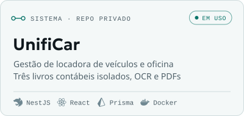
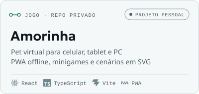
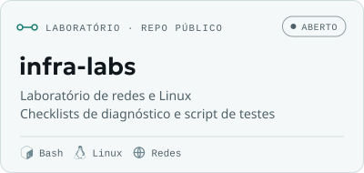
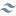
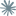
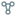
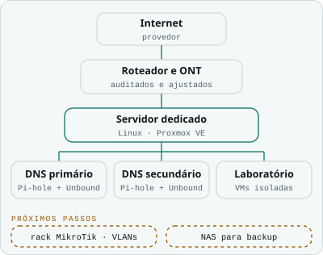

<!--
  README do perfil de @francistone.
  Imagens: pasta assets/, geradas por "npm run build" a partir de scripts/. Não edite os SVGs à mão.
  Os blocos entre os marcadores "nome:inicio" e "nome:fim" são reescritos automaticamente:
    destaque e stack: npm run build (dados em scripts/data/conteudo.mjs)
    atividade: Action semanal (.github/workflows/atividade.yml)
  Guia completo: MANUTENCAO.md
-->

<!-- ══════════ Cabeçalho ══════════ -->

<picture><source media="(prefers-color-scheme: dark)" srcset="assets/header-dark.svg"></picture>

<!-- Links essenciais: aguardam confirmação (PENDENCIAS.md, itens 1 e 3). -->

<!-- ══════════ Sobre ══════════ -->
### Sobre

Cuido de infraestrutura Linux e redes: um servidor dedicado com Proxmox, um homelab com DNS recursivo próprio e muito diagnóstico e ajuste fino de rede. Nos produtos, uso o Claude Code como IDE principal. Escrevo a especificação, divido o trabalho em fases e coordeno agentes que implementam, testam e revisam a segurança uns dos outros.

Sou *vibe coder* assumido. Não digito cada linha, mas respondo por cada decisão de arquitetura, e o que chega à produção passa antes por uma revisão independente. Fora do terminal: PC, games e automação no Windows com PowerShell.

<!-- ══════════ Em destaque (gerado: npm run build) ══════════ -->
### Em destaque

<!-- destaque:inicio -->

<picture><source media="(prefers-color-scheme: dark)" srcset="assets/card-meu-imovel-dark.svg"></picture>
<picture><source media="(prefers-color-scheme: dark)" srcset="assets/card-unificar-dark.svg"></picture>

<picture><source media="(prefers-color-scheme: dark)" srcset="assets/card-amorinha-dark.svg"></picture>
<a href="https://github.com/francistone/infra-labs"><picture><source media="(prefers-color-scheme: dark)" srcset="assets/card-infra-labs-dark.svg"></picture></a>

<!-- destaque:fim -->

<!-- ══════════ Como eu trabalho ══════════ -->
### Como eu trabalho

<picture><source media="(prefers-color-scheme: dark)" srcset="assets/fluxo-dark.svg"></picture>

Antes de qualquer código existe uma especificação versionada: produto, regras de negócio, arquitetura e segurança. O trabalho anda em **campanhas por fases**. Cada fase é uma missão autônoma, com testes, revisão por subagentes especializados e uma **auditoria independente** feita por outro modelo, que só lê e não edita.

Se a auditoria pede correção, o ciclo volta, no máximo duas vezes; na terceira, a decisão é minha. Produção, segredos e custos sempre passam por mim.

- Spec-Driven Development com `.specs/`, skills e subagentes
- MCP servers e automação de navegador
- Verificações automáticas: tipos, lint, testes e acessibilidade

 

<!-- ══════════ Stack (gerado: npm run build) ══════════ -->
### Stack

<!-- stack:inicio -->
| Domínio | Ferramentas |
| :-- | :-- |
| **Infra & Redes** |         Linux (Debian, Ubuntu)&nbsp;· Proxmox VE&nbsp;· LXC&nbsp;· Docker&nbsp;· Nginx&nbsp;· Caddy&nbsp;· Cloudflare (DNS, R2, Workers)&nbsp;· Pi-hole + Unbound |
| **Backend & Dados** |        PostgreSQL&nbsp;· Supabase (Auth, RLS)&nbsp;· NestJS&nbsp;· Prisma&nbsp;· Drizzle&nbsp;· Zod&nbsp;· Node.js |
| **Frontend** |       TypeScript&nbsp;· React&nbsp;· Next.js&nbsp;· Vite&nbsp;· Tailwind CSS&nbsp;· PWA |
| **IA & Agentes** |     Claude Code&nbsp;· MCP servers&nbsp;· Spec-Driven Development, subagentes e skills&nbsp;· Chrome DevTools MCP |
| **Automação & Qualidade** |       Bash&nbsp;· PowerShell 7&nbsp;· Python&nbsp;· GitHub Actions&nbsp;· Vitest&nbsp;· Playwright + axe |
| **Segurança (estudos)** |    Kali Linux&nbsp;· Hardening&nbsp;· Verificação de integridade&nbsp;· Isolamento de VMs |
<!-- stack:fim -->

<!-- ══════════ Homelab (recolhido) ══════════ -->

<b>Homelab</b>: rede, DNS e virtualização

 

<picture><source media="(prefers-color-scheme: dark)" srcset="assets/homelab-dark.svg"></picture>

Um servidor dedicado com Proxmox VE concentra o laboratório. O DNS da rede é recursivo e próprio: Pi-hole com Unbound em dois containers LXC, primário e secundário. O SSH só aceita chave.

VMs de estudo de segurança, como o Kali, ficam isoladas do resto da rede. Roteador e ONT passaram por auditoria e ajuste de desempenho.

**Próximos passos:** rack com MikroTik (RouterOS) e VLANs separando cada tipo de tráfego, e um NAS para backup.

 

<!-- ══════════ Atividade (gerado pela Action semanal; some se não houver dados) ══════════ -->
<!-- atividade:inicio -->
<!-- atividade:fim -->

<!-- ══════════ Rodapé ══════════ -->

<picture><source media="(prefers-color-scheme: dark)" srcset="assets/footer-dark.svg"></picture>

